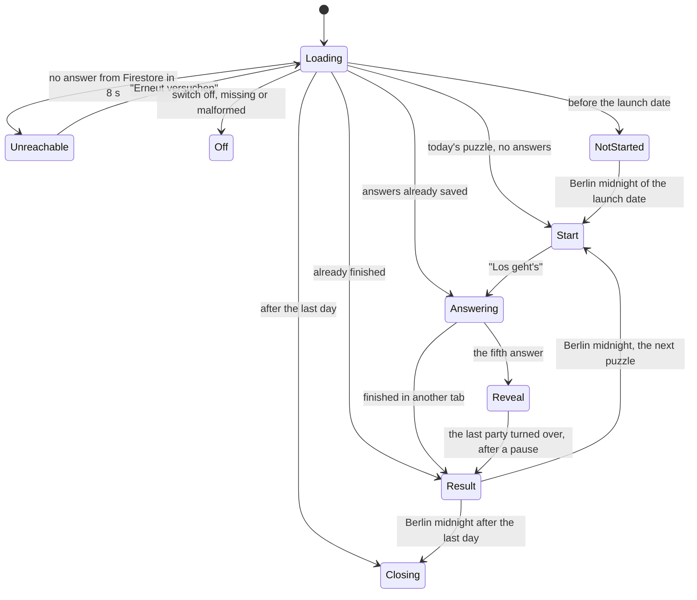
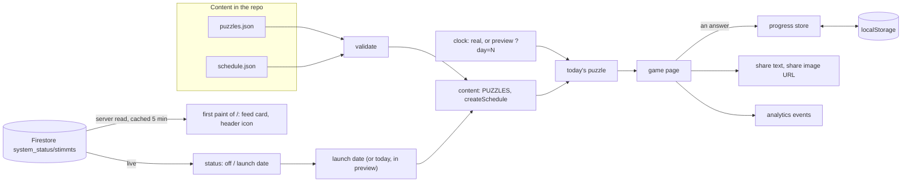

# Stimmt's? — design note

A daily puzzle for wahl.chat: players guess how each Fraktion in the Bundestag
voted on one real roll-call vote, see what happened, collect the day's
Stimmkarte in their Wahlperiode, and share the score.

Status: the game is complete, with all 30 puzzles of the pilot written and
scheduled, and **off by default**; it goes live by flipping a Firestore switch
(see the Stimmt's? section in `AGENTS.md`). The feed on `/` invites to it
with a card above the Hot Topic, and players find their result through an
icon in the header. The chat card on the result screen is built but switched
off until the general chat exists. See [Status and rollout](#status-and-rollout).

## Why it exists

- wahl.chat traffic follows the election calendar and drops between elections.
  A daily puzzle gives people a reason to come back in quiet periods.
- It teaches how the parties actually vote, which is often not what their
  reputation suggests; the puzzles are picked for exactly those surprises.
- A result that can be shared brings in new visitors.
- Once the general chat exists, every puzzle can end with a door into it, to
  ask why a party voted the way it did.

## The game

One real Bundestag roll-call vote per day. Everyone gets the same puzzle on the
same day, where a day is a calendar day in Berlin. The run lasts 30 days, one
Wahlperiode, starting on the launch date.

1. **First visit.** "So funktioniert's" opens once: four short rules, including
   that a vote can be a few months old. It can be reopened with the (i) button
   "So funktioniert’s" in the logo row.
2. **Start screen.** The task as the heading ("Rate, wie die 5 Fraktionen
   abgestimmt haben.") with the five party logos, each with a "?". Under it
   the briefing card: topic and date, the title, what "Ja" means, and three
   key points, each with its source page. "Mehr Info" adds the briefing and
   "Das Dokument" (the Drucksache's cover data and PDF); it expands on phones
   and turns the card to its back side on desktop. "Los geht’s" is pinned to
   the bottom of a phone's screen. A visitor who opens a friend's shared
   result sees the challenge banner above it (see Sharing).
3. **Answers.** The Fraktionen come one at a time in seating order: Die Linke,
   SPD, Bündnis 90/Die Grünen, CDU/CSU, AfD. For each, Ja, Nein or Enthaltung.
   An answer is final.
4. **Reveal.** One "Auflösen" button turns all five parties over, left to
   right; a tap on a party's row turns just that one. Each party's real vote
   and counts show beside the player's tip. When the last party is turned
   over, the result follows by itself after a short pause (almost at once with
   reduced motion). A vote looked at again from the result, without tips, has
   no such move: it has its own "Zurück zum Ergebnis" button.
5. **Result.** From the top: the stamped Stimmkarte (the score, a verdict
   per party), which the player casts into the urn of this Wahlperiode, and
   the urn; the vote result card, which opens the vote again; the slot for the
   chat card (switched off); the Wahlperiode as 30 seats, where a past day
   opens again. The card leads so it is on screen when the result opens. Once
   it is cast, the countdown to the next puzzle takes its place and a compact
   score card under the urn keeps the score on screen and holds sharing (and,
   through a slot, the style button). The goal of the screen is to cast the
   card, see how the Bundestag voted and ask about it; feedback and old days
   come second.
6. **After the first finished puzzle,** once: whether we should make more
   small games („Ja, gern" / „Eher nicht").
7. **After the last day,** a closing screen: the player's Wahlperiode, how many
   days they played and how many tips were right, and "Weitere Quizze sind in
   Arbeit. Bleib dran!"

## Screens and states

| Screen | Shows | When |
| --- | --- | --- |
| Loading | the logo, pulsing | until the switch and the saved progress are read |
| Unreachable | "Gerade nicht erreichbar", retry | Firestore silent for 8 s (ad blocker, firewall, offline) |
| Off | "Kommt bald" | switch off, doc missing, or a malformed launch date |
| Not started | "Bald geht's los", the date; a countdown on the eve | before the launch date |
| Start, Answering, Reveal, Result | the game | from the launch date to the last day |
| Closing | the Wahlperiode, the numbers, "Weitere Quizze sind in Arbeit" | after the last day |

A page left open past midnight moves to the new day by itself, also when a
sleeping phone or a frozen tab held the timer back, and says so in a short
notice ("Neuer Tag, neues Quiz"), adding that unfinished tips no longer
count.

## Decisions and why

**Product**

- Federal level only, the five Fraktionen (CDU/CSU is one, stored as `cdu`).
  The validator requires exactly these, in seating order.
- One shot per party, score 0 to 5. Retries would take the suspense out of the
  reveal.
- Players predict what parties did; they are never asked for their own
  position. Political opinions are special-category data (see `AGENTS.md`),
  and a prediction is not an opinion.
- No streak. The Wahlperiode (one seat per day, 30 days) shows the player's
  run instead, and missed days stay visible as missed: there is no catching
  up. It is worked out from the saved games, so it can never disagree with
  them.
- A party is summed up as the option most of its members chose. A vote where
  a Fraktion split (less than 80 percent for one option) is not a fair puzzle,
  and the validator refuses it.

**Launch and the switch**

- One public-read Firestore doc, `system_status/stimmts`
  `{enabled, launch_date}`, read live. For the first paint of `/` (the feed
  card and the header icon) it is also read on the server, cached for 5
  minutes; a failed read counts as off and is not cached. The launch date is day 1, so the
  committed content holds no dates and the calendar starts whenever the game
  is switched on. Anything unclear (missing doc, `enabled` not exactly true, a
  date that does not exist) means off, so a typo can hide the game but never
  start it on the wrong day.
- The launch date must not change once anyone has played: it would renumber
  every day. Switching off and on does not pause the calendar.

**Content**

- Puzzles are data in the repository: `puzzles.json` is the library (every
  reviewed puzzle, spares included), `schedule.json` the running order.
  Swapping a puzzle is a one-line edit; [CONTENT.md](CONTENT.md) is the guide.
- **Committed means approved.** There is no draft status: the whole file ships
  to the browser, so a draft could not be kept out anyway. A batch is reviewed
  before it is committed.
- Future days' answers are in the bundle too. They are public facts about past
  votes; the switch hides the game, not the data.
- After launch, only days not yet shown may change.

**Sharing**

- The shared text carries the vote's title, the score and an invitation,
  nothing per party, so it gives nothing away to someone who has not played:
  the title is public on the start screen anyway. Two games of the same day
  with the same score share identical text (tested).
- On phones the share sheet gets the text and the image together; elsewhere
  the text is copied and the image can be saved; if copying fails, the text is
  shown to copy by hand.
- The share image (`/stimmts/share`, square, story and link preview) is drawn
  from its URL: format, number, score, the day it was played, and the
  player's period as one character per day. It shows the vote's title too,
  looked up in the committed content by the number (`n`), never read from the
  URL, so nobody can put words on it. It still shows no per-party result.
  Nothing is stored, and the image needs neither the launch date nor a
  database.
- A shared result links to `/stimmts?n=…&s=…&d=…`. A visitor who opens it
  sees a challenge banner above the start screen ("Schaffst du mehr als
  3/5?"), but only when `d` is today, since another day's score is a
  different quiz, and only while the visitor has not finished today's
  puzzle. The parameters are checked like the share image's.
- Each image has one canonical URL; any other spelling redirects to it, so the
  CDN holds each image once. Its fonts are loaded once per server; if they
  cannot be loaded, the image is drawn in next/og's own face and not cached.
- The plain `/stimmts` link previews a general card with no number or date,
  which is right whether or not the game is running.

**Measuring**

- Vercel Analytics events: `stimmts_puzzle_started`,
  `stimmts_puzzle_completed` (day, score), `stimmts_result_shared` (screen,
  method, day) and `stimmts_more_games` (answer: yes, no or dismissed;
  games; placement: feed). Each puzzle is counted once, not again on a reload or in another
  tab. Only counts leave the device, never the tips.
- Feedback is one tap, asked once in the feed, as a small card at the bottom of
  the screen on a feed visit after the first finished puzzle (not on the visit
  where the fly-in plays): „Stimmt’s?
  ist neu. Sollen wir mehr kleine Spiele machen?" with „Ja, gern" and „Eher
  nicht". It asks about the format, never about the vote, so the card names no
  bill. An answer or a close both count as asked. While the PledgeTracker
  study runs the card is hidden, because the study questionnaire is then the
  only ask in the app.

**Accessibility**

- Playable by keyboard and screen reader: focus moves to each new screen's
  heading, the next party is announced, the answer buttons keep focus through
  the double-tap guard. The chamber is one image to a screen reader; the list
  under it ("Deine Tipps") offers the same actions as real buttons.
- Fits 320 px screens ("Enth." below about 370 px), and the Wahlperiode's seats
  have tap areas larger than their dots.

**The chat card (switched off)**

- The point of the game is to learn, and the natural next question is "why
  did this party vote that way?". The chat card on the result screen offers
  three questions as chips (why a party voted as it did, whether the bill is
  in force, what happens next) and a free question. It is built and sits
  behind `STIMMTS_CHAT_ENABLED` in `chat-chips.ts`, committed `false`: its
  answers are a local placeholder until the general chat exists, since chats
  today exist only per election. Before enabling it, check that the chat
  route handles the `q` and `party_id` parameters the card links with. It
  must never open a study context.

**Technical**

- Everything the player has done lives on the device (`localStorage`);
  nothing about the player is stored on the server.
- The rules are plain functions without a browser, tested directly; the
  components display state and forward taps. Firestore is only touched by the
  switch listener, so the rules stay testable with `bun test`.

## Architecture

### Principles

- **Parse, don't cast.** Puzzle files, the switch doc and saved progress are
  checked when read. A broken puzzle file fails the tests and the build;
  damaged saved data is dropped instead of breaking the page, and a save from
  a newer version of the game is left alone rather than overwritten.
- **Hydration-safe.** The server and the first browser render show the same
  loading state; saved progress, the time and the address are read after
  mount. The feed card and the header icon sit on a shared, cached page: an
  inline script marks `<html>` with this device's presence before first
  paint, CSS shows or hides them from that mark, and the card keeps fixed
  empty slots for the name and countdown until mount, so the feed never
  moves.
- **The Berlin clock.** "Today" is the Berlin calendar date, never the
  player's own. The next midnight is found by bisection, which stays correct
  on the 23-hour and 25-hour days.
- **Answers are final and saved on tap.** The screen is derived from the saved
  answers, so a reload resumes where the player was and cannot take an answer
  back. Every write starts from what is saved, so an older tab cannot
  overwrite a newer one.

### Where things live

| Area | Files (in `web/lib/stimmts/` unless noted) |
| --- | --- |
| Contract and content | `types.ts`, `validate.ts`, `content.ts`, `content/puzzles.json`, `content/schedule.json`; test fixtures in `fixtures/` |
| Switch and launch | `status.ts`, `use-stimmts-status.ts`; the listener in `web/lib/firebase/firebase.ts`, the cached server read in `web/lib/firebase/firebase-server.ts` |
| Feed and header | `feed-entry.ts` (what the feed card shows), `presence.ts` (the mark on `<html>`), `todays-result.ts`, `flip.ts` (the fly-in's transform); `web/components/daily/stimmts-feed-card.tsx`, `stimmts-header-icon.tsx`, `stimmts-fly-in.tsx` |
| Time and schedule | `berlin-time.ts`, `schedule.ts`, `preview.ts`, `countdown.ts` |
| Game rules | `score.ts`, `progress.ts`, `period.ts` (the Wahlperiode) |
| State | `progress-store.ts`, `use-progress.ts` |
| Sharing | `share.ts`, `share-action.ts`, `share-image.ts`, `load-once.ts`, `challenge.ts` (the banner for a shared link) |
| Start screen and chat | `start-view.ts`, `drucksache.ts` (PDF and source-page links), `chat-chips.ts`, `chat-question.ts` |
| Measuring | `analytics.ts`, `feedback.ts` |
| Look | `fonts.ts`, `parties.ts`, `hemicycle.ts`, `chamber-state.ts`, `game-view.ts`, `logo.ts`; logos in `web/public/images/stimmts/logos/` |
| Wording | `labels.ts` |
| Screens | `web/components/stimmts/`: `stimmts-game` (switch, clock, store, which state), `puzzle-game` (which screen), `start-screen`, `more-info`, `key-points`, `start-bar`, `guess-step`, `reveal`, `result`, `vote-result-card`, `chat-card`, `closing-screen`, `status-screen`, and their parts |
| Routes | `web/app/(wide)/stimmts/page.tsx`, in the feed's header and theme (not indexed until launch) and the share image at `web/app/stimmts/share/route.tsx`; `/stimmts` is a static page in `web/middleware.ts` and a reserved segment for page visits |

### Preview mode

For testing before and after launch. It is on in local development and
wherever `NEXT_PUBLIC_STIMMTS_PREVIEW=true`, and never on Vercel's production
deployment (decided on the server, where `VERCEL_ENV` is known).

- The game plays even while the switch is off: day 1 is the configured launch
  date if there is one, otherwise today.
- `?day=N` opens the N-th day, up to the day after the last puzzle (the
  closing screen).
- A bar at the bottom resets one puzzle, keeping the other days, or
  everything.

## Content

How to swap or add a puzzle is in [CONTENT.md](CONTENT.md).

### The puzzle contract

- id, date of the vote, topic label, neutral title
- `shortName`, the feed card's name after "Heute: ": article and noun, at
  most 22 characters ("Der Tankrabatt")
- a spoiler-free briefing and a "Ja bedeutet …" line
- optionally `keyPoints`: three short points for the start screen, each with
  its source as `{document, page}` (a Drucksache of the puzzle and the PDF
  page)
- the overall outcome
- per Fraktion, in seating order: the answer and the counts (yes, no,
  abstain, did not vote); the members without a Fraktion, so the chamber
  shows all 630 seats
- optionally the bill's Drucksache (type, number, date, who submitted it, the
  full official title, the PDF, the version voted on), copied exactly; without
  it the briefing uses a plain layout
- the source link (the vote's Abgeordnetenwatch page)

### What the data showed

From Abgeordnetenwatch's data for the 21st Bundestag (October 2026):

- **85 roll-call votes** in the term, 46 of them in 2026. Several fall on the
  same day and topic, so the pool of distinct puzzles is smaller, but enough
  for 30 plus spares.
- **Parties vote as blocs**, so the 80 percent rule rarely refuses a vote.
- **Union and SPD almost always vote alike** (coalition discipline). The
  surprises live in the opposition and in Enthaltung, so votes are picked for
  variety of patterns.
- **"Ja" does not always mean what it sounds like.** On a committee's
  recommendation Ja can mean "reject the motion"; hence the explicit line.
- **The official description gives the answer away** ("hat zugestimmt", the
  tally), so the briefing is a short neutral rewrite, read by a person.
- **The sources are not always right.** Abgeordnetenwatch marked one vote as
  accepted that its own counts show was rejected, and DIP spells a Fraktion
  differently from the printed cover. The exporter flags an outcome that
  contradicts the counts, and the reviewer checks the Drucksache against its
  PDF.

### Data source

Puzzles are drafted by `ingestion/scripts/stimmts/export.py` from
Abgeordnetenwatch's public API (votes and per-member results, tallied with the
chat corpus's own code) and, for the bill sheet, the Bundestag's DIP API
(Drucksachen). The stored chat corpus is not used: it lacks the Drucksache
links the bill sheet needs. DIP names the first signers of a motion and their
total, hence the optional `memberCount`. The exporter leaves the text to a
person and notes what it cannot word with certainty (a motion of several
Fraktionen, several linked bills). The game never calls these APIs at runtime;
everything is prepared offline and committed.

### Choosing the votes

Written down before picking, so the selection can be defended as neutral:

- 21st Bundestag roll-call votes.
- At most one puzzle per topic cluster, and votes on the same day kept apart.
- Prefer direct laws and motions; a committee recommendation only when "Ja
  bedeutet …" fits in one clear sentence.
- Many distinct topics, motions from government and opposition, a mix of
  angenommen and abgelehnt, and at least a third with a real surprise.
- Sensitive topics are fine when framed neutrally; no run of puzzles should
  feel one-sided.

## Constraints

- **Neutrality.** Facts with sources only, no loaded framing.
- **Privacy.** Progress stays on the device. Nothing political about the
  player is stored or sent.
- **Same puzzle for everyone.** Puzzle N is a function of the Berlin date and
  the launch date. The answers ship to the browser, which is acceptable for a
  casual game.
- **Translation.** Browsers that translate the page rewrite text in place and
  garble anything updating every second, so the countdown is not translated.

## Testing

Unit tests cover the content contract, the switch, the Berlin day including
both clock changes, the launch-relative schedule, scoring, saving and resuming
(including other tabs and newer saves), the Wahlperiode, the preview clock,
the share text, image URLs and share action, the font loader, the countdown
and the feedback rule, the feed card's rules (when it shows, the countdown,
its spoken label) and the presence mark (the inline script run as it
runs in the page). They run on fixtures, so real content can change
without touching them; separate tests check the shipped content.

Checked in a browser: every switch state live, the share route (valid,
redirected and refused URLs, a font outage), keyboard and screen-reader
flows, 320 px and 375 px widths, two tabs, and a tab moved past midnight.
On `/`: the feed card for a new reader and for a player, with no flash and no
shift of the feed; the header icon and its check; the fly-in after a game,
with and without reduced motion; and the switch flipped while the page is
open.
The logic that lives in components and hooks (which screen shows, a game
finished in another tab, counting each event once, the new-day notice, the
switch's 8-second timeout) has no automated test, since the web tests run
without a browser; the browser checks above are its only coverage, so repeat
them after changing it.

## Status and rollout

**Done:** the game, the switch, the status and closing screens, the intro,
sharing, robustness, accessibility, analytics and the more-games question; the
landing-page card on `/` and the header icon; the exporter;
the 30 puzzles, reviewed in three batches, and their running order (see
[puzzle-selection.md](puzzle-selection.md) for why each vote was picked).

**Next.**

1. *Review and test:* an independent code and content review and a local
   test, then the branch as a draft pull request for the team to try.
2. *The chat card,* built and switched off: enable it once the general chat
   exists.
3. *Launch:* indexing (`productionRobots`, canonical, sitemap) and the
   production switch doc.

**Judging the pilot.** Return rate, completion, shares and the answers to the more-games question over the 30
days.

## Risks and open questions

- **Content quality.** Each briefing must be neutral and correct; it is the
  slowest part of the work.
- **The chat link** depends on the general chat, and whether it reliably finds
  a vote from 2025 or 2026 is untested.
- **Sharing on Instagram** is up to Instagram: a website cannot add an app to
  the share sheet.

## Later ideas

- Other modes: "Welche Partei?" with clues, civic trivia, a coalition builder.
  Regional editions.
- A crowd statistic ("62 % hatten alle richtig"), which needs a server-side
  counter.
- Topic tags as a first interest signal. A per-user profile needs the
  explicit consent gate first.
- A weekly vote generated from newly ingested votes.
