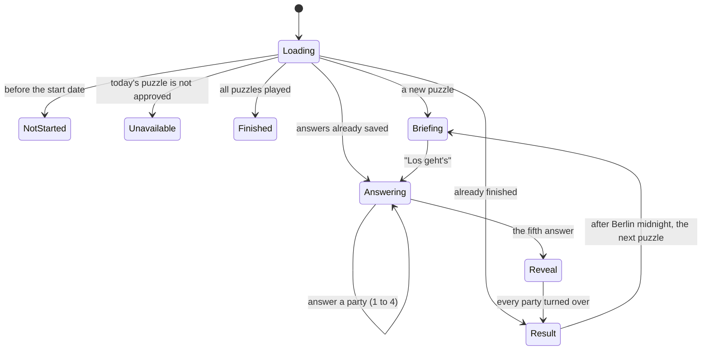
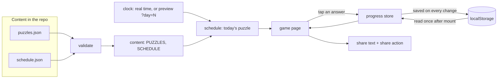

# Stimmt's? — design note

A daily puzzle for wahl.chat: players guess how each party in the Bundestag
voted on one real roll-call vote, see what happened, keep a streak, share the
score, and can ask the chat why.

Status: the playable game runs on a hidden page in its designed look (the
Stimmt's? design system: the chamber as the board, the Stimmkarte, the bill
sheet, the urn and the player's Wahlperiode, and a share image). Real content
and the launch wiring are still ahead, and the link into the chat is postponed.
See [Status and rollout](#status-and-rollout).

## Why it exists

- wahl.chat traffic follows the election calendar and drops between elections.
  A daily puzzle gives people a reason to come back in quiet periods.
- It moves the product towards "learn about politics regularly" without a
  large architectural change: it reuses the vote data the chat already has.
- It is a funnel: every puzzle ends with a door into the chat.
- A result that can be shared brings in new visitors.

## The game

One real Bundestag roll-call vote per day. Everyone gets the same puzzle on the
same day, where a day is a calendar day in Berlin.

1. **Entry.** Today's puzzle on its own page (later also a card on the
   landing page).
2. **Briefing.** Title, date, a short neutral description of what is being
   decided, and an explicit line saying what a "Ja" means. It never reveals the
   result.
3. **Answers.** The parties come one at a time, in seating order from left to
   right: Die Linke, SPD, Bündnis 90/Die Grünen, CDU/CSU, AfD. For each, the
   player answers "Wie hat die Partei abgestimmt?" with Ja, Nein or
   Enthaltung. An answer is final.
4. **Reveal.** The player turns the parties over one by one, or all at once,
   and sees what each party did, with the real vote counts.
5. **Result.** Score out of five, the streak and its record, a share button, a
   countdown to tomorrow's puzzle, and a link to the source.
6. **Mehr erfahren (later).** What each party said in the debate, with
   sources, once that content exists. A link into the chat is postponed, see
   the decisions below.

## Screens and states

What the player sees, when, and what they are asked to do. The look is plain
on purpose, until the design language of the news page is settled.

| Screen | The player sees | The player does | When |
| --- | --- | --- | --- |
| Loading | "Lädt …" | nothing | until the browser's saved data is read |
| Not started | the start date | nothing | before the schedule's start date |
| Unavailable | "noch nicht freigegeben" | nothing | today's puzzle is not approved |
| Finished | "alle bisherigen Rätsel gespielt" | nothing | after the last scheduled puzzle |
| Briefing | the Stimmkarte (title, topic, number, day), the bill sheet (the Drucksache's cover, our neutral summary, the vote's date, what "Ja" means, the original PDF), the empty chamber | taps "Los geht's" | a new puzzle with no answers yet |
| Answering | the chamber, the party card: "Partei n von 5", the party's logo and name, three buttons, "Ja bedeutet …" | answers Ja, Nein or Enthaltung (or keys 1 to 3); each answer is final, with a short pause before the next party, and paints the party's wedge as rings | after the start, until the fifth answer; also after a reload mid-game |
| Reveal | the chamber with its legend, "Ja bedeutet …", "Deine Tipps": the tip beside the real vote | turns parties over from their logo on the chamber or one by one, or all at once | after the fifth answer |
| Result | the stamped Stimmkarte, the player's Wahlperiode with the streak and record, "x von 5 richtig" with a verdict per party, the outcome, the share button, the source | casts the card into the urn (the countdown then appears under the Wahlperiode), shares, taps a past day's seat to see its card | once every party is turned over; straight away after a reload of a finished game |

### Open mechanics questions

For the product owner to settle before the look is designed:

1. Should the outcome (angenommen or abgelehnt) be shown before answering, or
   only after, as now?
2. Reveal: tap per party, all at once, or automatic with a short delay?
3. Should an answer be final, as now, or can it be changed until the last
   party?
4. Union and SPD always vote the same way. Keep five seats, merge them into one
   "Koalition" seat, or add a bonus question?
5. Streak: days played (now) or days won? Shown with the record?
6. After finishing, is there anything more to do today (an archive, a second
   question), or only share and the countdown?
7. A missed day's puzzle is gone for good (no archive). Is that intended?

## Decisions and why

These are kept easy to change on purpose; the first two groups are the ones to
confirm with the product owner.

**Product**

- Federal level only, five seats (CDU/CSU is one party, stored as `cdu`).
- One shot per party, score 0 to 5, no difficulty levels. Retries would add
  state and take the suspense out of the reveal.
- Players predict what parties did; they are never asked for their own
  position. Political opinions are special-category data (see `AGENTS.md`),
  and a prediction is not an opinion.
- The streak counts days played, not days won, so a bad score never breaks it.
  It is worked out from the saved games, like the player's Wahlperiode (one
  seat per day, 30 days), so the two can never disagree.
- Pilot: 30 puzzles, one a day, picked by hand against written criteria.
  Proposed launch: 1 November 2026, as puzzle number 1.

**Sharing**

- The shared text carries the puzzle number, the score and an invitation, and
  nothing else: no per-party grid, no topic. A per-party grid hints at the
  answers to anyone who has not played yet. A test shows that two games with
  the same score produce identical text.
- On phones the button opens the system share sheet with the text and the
  share image together, so the apps offered are whatever the phone has
  installed. Elsewhere it copies the text to the clipboard and offers the image
  to save, and if even copying fails it shows the text to copy by hand.
- The share image (`/stimmts/share`, square, story and link preview) is drawn
  from its URL alone: the number, the score and the player's period as one
  character per day. Nothing is stored on a server. Like the text, it never
  shows the topic, the title or anything per party. The shared link carries
  the number and the score, so its preview shows them.

**Content**

- Puzzles are data in the repository (`puzzles.json`), not a database. A
  separate `schedule.json` says which puzzle runs on which day, so swapping,
  reordering or dropping a puzzle is a one-line edit.
- Every puzzle has a review status, draft or approved. Production serves only
  approved puzzles. A puzzle without an approved status shows as "not yet
  released" instead of breaking the day.
- Party reasons are shown only with a source. A party without one says so; the
  game never shows a guess.

**Chat handoff (postponed)**

- Postponed by the product owner. A chat exists only per election, so the only
  one available for Bundestag votes is a past election's. A general "ask the
  parties" chat is to follow once the data pipeline runs for all states.
- The design is kept for when it is picked up: a link to a chat with all five
  parties and the puzzle's question, sent immediately (`q`) because the player
  has just pressed a button asking for exactly that. It must never target a
  study context, and the link should be built in one small module, so a change
  to the chat's routes is a one-file edit.

**Technical**

- Everything the player has done lives on the device (`localStorage`); nothing
  about the player is stored on the server.
- Mechanics before looks: what the player sees, when, and what they are asked
  to do is settled first. The visual design waits for the landing page redesign
  in review; the game uses plain styling until it merges, then reuses its
  hemicycle, palette and seating order. Plan B: if it is not merged in time for
  launch, ship the game on its own page with a simple link and integrate later.

## Architecture

### Principles

- **A pure core with thin shells.** The rules (which puzzle is today's, the
  score, the streak, the share text, the saved-progress logic)
  are plain functions with no browser in them, tested directly. The React
  components only display state and forward taps.
- **Parse, don't cast.** Puzzle files and saved progress are checked when they
  are loaded. A broken puzzle file fails the tests and the build; damaged saved
  data is dropped instead of breaking the page.
- **Hydration-safe.** The server and the first browser render show the same
  empty state. Saved progress, the time and the address are read only after the
  page has mounted.
- **The Berlin clock.** "Today" is the Berlin calendar date, never the
  player's own. The moment tomorrow's puzzle opens is found by bisection, which
  stays correct on the 23-hour and 25-hour days when the clocks change. A page
  left open past midnight switches puzzles by itself.
- **Answers are final and saved on tap.** Which screen shows is derived from
  the saved answers, so a reload resumes exactly where the player was and
  cannot be used to take an answer back. A short delay after each new party
  stops a double tap from answering two.

### Where things live

| Area | Files |
| --- | --- |
| Contract and content | `web/lib/stimmts/types.ts`, `validate.ts`, `content.ts`, `content/puzzles.json`, `content/schedule.json` |
| Time and schedule | `berlin-time.ts`, `schedule.ts`, `preview.ts` |
| Game rules | `score.ts`, `progress.ts`, `period.ts` (the Wahlperiode), `streak.ts` |
| State | `progress-store.ts`, `use-progress.ts` |
| Sharing | `share.ts`, `share-action.ts`, `share-image.ts`, `countdown.ts` |
| Look | `fonts.ts`, `parties.ts`, `hemicycle.ts`, `chamber-state.ts`, `game-view.ts`, `logo.ts` |
| Wording | `labels.ts` |
| Screens | `web/components/stimmts/`: `stimmts-game` (clock, store, states), `puzzle-game` (which screen), `briefing`, `guess-step`, `reveal`, `result`, and their parts (`hemicycle`, `stimmkarte`, `bill-sheet`, `wahlperiode`, `share-image`, …) |
| Routes | `web/app/(with-header)/stimmts/page.tsx` (not indexed until release) and the share image at `web/app/stimmts/share/route.tsx`; `/stimmts` is registered as a static page in `web/middleware.ts` |

### Preview mode

For developing before launch. It is on in local development and wherever
`NEXT_PUBLIC_STIMMTS_PREVIEW=true`, and off in production, so players only get
the real puzzle of the day.

- `?day=N` opens the N-th day of the schedule, drafts included.
- A bar at the bottom resets one puzzle (keeping the streak and the other
  days, so streaks across days can be tested) or everything.

## Content

### The puzzle contract

Each puzzle is prepared and reviewed ahead of time:

- id, review status, date of the vote, topic label
- the number of members without a Fraktion, so the chamber shows every seat
- optionally the bill's Drucksache (type, number, date, who submitted it, the
  full official title, the PDF, and the version voted on), copied exactly and
  checked by a person; without it the briefing shows the plain layout
- neutral title, spoiler-free briefing, "Ja bedeutet …" line
- the overall outcome
- per party, in seating order: the answer (Ja, Nein or Enthaltung) and the
  counts (yes, no, abstain, did not vote)
- per party: a reason with a short quote and a source, or no entry
- a link to the source, and the question used to open the chat

The validator rejects a puzzle whose parties are too split to have one answer:
the answer must hold at least 80 percent of the votes cast.

### What the data showed

From the public Abgeordnetenwatch data for the 21st Bundestag:

- **72 roll-call votes in the term, 33 since January 2026.** Enough for a
  pilot with little slack. Several cluster on one day, so 2026 holds roughly 20
  distinct topics and the rest will come from 2025. New votes keep arriving.
- **Parties vote as blocs.** In all 33 votes every party was between 92 and
  100 percent on one side, so the unity rule almost never fires.
- **Union and SPD voted identically in all 33.** Coalition discipline means
  four free decisions per puzzle, and regular players will notice. The surprise
  lives in the opposition seats and in Enthaltung, so votes are picked for
  variety. If it makes the game too easy, a bonus question is an option.
- **"Ja" does not always mean what it sounds like.** Many votes are on a
  committee's recommendation ("Ablehnung eines Antrags …"), where Ja means
  "reject the motion". Hence the explicit line, and a preference for direct
  laws and motions.
- **The official description gives the answer away** ("hat zugestimmt", the
  tally, who argued for it) and runs to thousands of characters of HTML. The
  briefing is a short neutral rewrite, approved by a person.
- Party labels can carry an invisible soft hyphen (the Greens).

### Data source

The vote facts come from the votes already stored for the chat. One stored
vote holds the title, date, the Abgeordnetenwatch poll id and page, the
participating parties, the per-party counts, the outcome, and a text made of
the title, topics and description. Using it means the puzzle and the chat can
never disagree about a vote, and the party mapping and tallies are already
tested.

An offline export script will read that data and write the puzzle files; the
game itself never talks to the vector store. What the stored copy lacks: links
to the original Bundestag documents (the Abgeordnetenwatch page is the source
link instead), and a separate topic field.

Overlap to resolve: the daily-feed landing work in review also builds per-vote
party results and per-party debate positions with sources. If it lands, it may
replace most of the export and reasons pipeline.

### Choosing the votes

Written down before picking, so the selection can be defended as neutral:

- 21st Bundestag roll-call votes, 2026 first, reaching into 2025 as needed.
- At most one puzzle per topic cluster.
- Prefer direct laws and motions; avoid "Ablehnung von …" votes unless "Ja
  bedeutet …" fits in one clear sentence.
- At least eight distinct topic labels, and motions from both government and
  opposition.
- At least a third with a real surprise (a seat that breaks the expected
  pattern), and a mix of angenommen and abgelehnt.
- Sensitive topics are fine when framed neutrally; no run of puzzles should
  feel one-sided.

### Reasons: sourced or absent

An invented motive attributed to a real party would damage the trust the
product depends on, so:

1. Reasons come from the plenary debate on that vote: speeches are found by
   the vote's date and the party, ranked by similarity to the subject, and a
   person confirms they belong to that agenda item.
2. Every reason cites a speech (speaker, protocol, page) and a short quote.
3. It is worded as attribution ("Die Linke begründete ihr Nein in der Debatte
   mit …"), never as inference ("… lehnt ab, weil …").
4. Some votes have no debate, or a party did not speak: then the screen says
   so.
5. A person reads every one before it goes live, with the same length and tone
   for every party.
6. They are generated in advance, never while the player waits.

The link between a vote and its debate is not stored anywhere, so this lookup
is the least certain part of the plan and is tested on a few votes first.

## Constraints

- **Neutrality.** Facts with sources only, no loaded framing.
- **Privacy.** Progress and streak stay on the device. Nothing political about
  the player is stored.
- **The study.** The game never opens a chat in the study contexts, and must
  respect the rule that the study questionnaire is the only thing anyone is
  asked while the study runs.
- **Same puzzle for everyone.** Puzzle N is a function of the Berlin date.
  The answers ship to the browser, which is acceptable for a casual game.
- **Translation.** Browsers that translate the page rewrite text in place and
  garble anything that updates every second, so the countdown is marked as not
  translatable.

## Testing

The rules are covered by unit tests: the content contract, the Berlin day
including both clock changes, scheduling and drafts, scoring, streaks across
days and reloads, saving and resuming, the preview clock, the share text and
share action, and the countdown format.

Checked by hand, because it needs a browser: the screens and the reveal, the
share sheet and clipboard, the translated page, and reload and resume. Not yet
exercised live: the page switching itself at Berlin midnight.

## Status and rollout

**Done (phase 1, the playable skeleton).** Contract and sample puzzles, the
rules, saving, the hidden page with all screens, preview mode, sharing and the
countdown.

**Next.**

0. *Settle the mechanics* with the product owner, using the screens and open
   questions above.
1. *Real content.* Load the current term's votes locally, export draft
   puzzles, write and approve the briefings, find and review the sourced
   reasons, fill and schedule the 30 puzzles.
2. *Look and feel.* Done on the game page. The landing page entry (the game
   as one row, the player's Wahlperiode once played) waits for the landing
   page work, whose hemicycle layout the game should then share.
3. *Release.* Landing page card, a kill switch modelled on the study one,
   analytics (started, finished, shared), remove the
   noindex, and a launch checklist.

**Launch checklist.** At least the first week of puzzles approved, with
approvals kept ahead of the calendar; the kill switch working; analytics in place; the page indexed; a tab left open through the
first midnight.

**Pull requests**, small and invisible until the last: the logic and state,
the page, the content and scripts, then the landing card and switch, which is
the launch.

**Judging the pilot.** Return rate, streak lengths and shares, after about 30
days.

## Risks and open questions

- **Supply and quality of puzzles.** Few votes per month, near-duplicates, and
  the fixed Union and SPD pairing.
- **The reasons lookup** (vote to debate) is unproven.
- **The chat link, when it returns.** Whether a chat reliably finds a vote from
  2026 is unverified and should be checked on a deployed copy.
- **Timeline.** The content work, not the code, decides whether 1 November
  holds.
- **Landing page.** The visual integration depends on a change still in review.
- **Sharing on Instagram** is up to Instagram: a website cannot make an app
  appear in the share sheet, and plain text cannot go to a Story. A share image
  would help.

## Later ideas

- Other modes: "Welche Partei?" with progressive clues, civic trivia, a
  coalition builder. An archive of past puzzles. Regional editions.
- Hemicycle share image; a crowd statistic ("62 % hatten alle richtig"), which
  needs a server-side counter.
- Per-party chat links on the result screen.
- Topic tags as a first interest signal for personalization. A per-user
  profile needs the explicit consent gate first.
- Reminders through the installed app; upgrading the anonymous user to a login
  so streaks survive a cleared browser.
- A weekly vote of the week generated from newly ingested votes.
