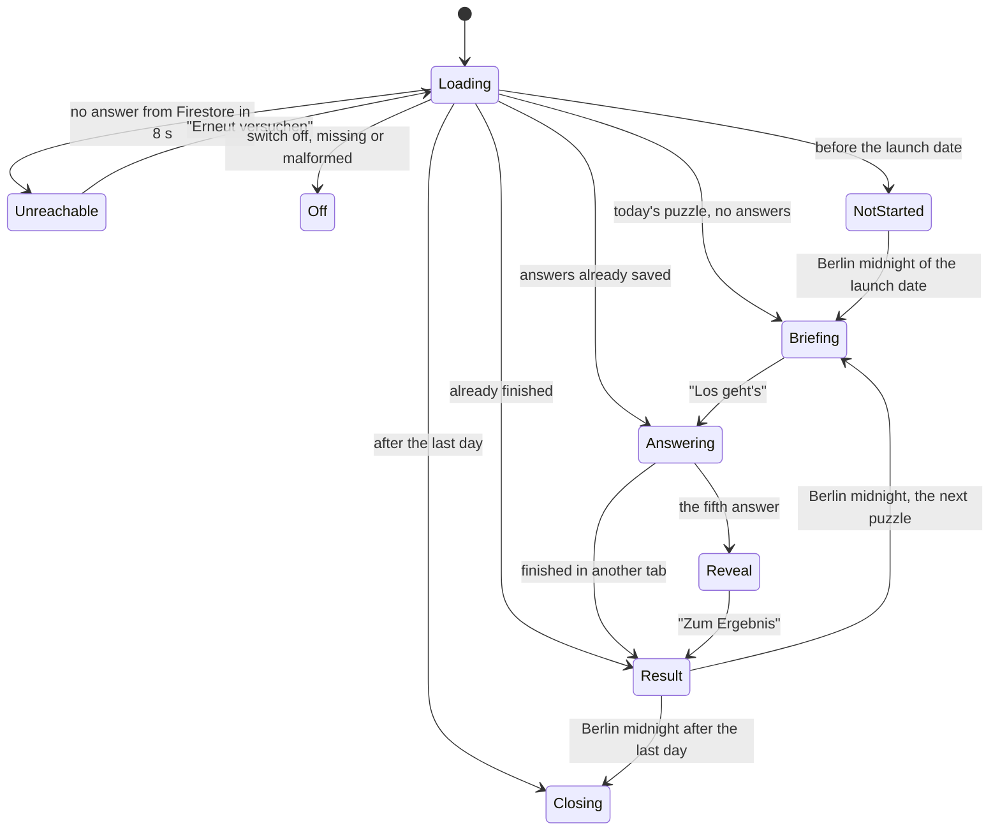
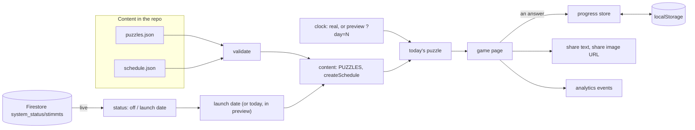

# Stimmt's? — design note

A daily puzzle for wahl.chat: players guess how each Fraktion in the Bundestag
voted on one real roll-call vote, see what happened, collect the day's
Stimmkarte in their Wahlperiode, and share the score.

Status: the game is complete and **off by default**; it goes live by flipping
a Firestore switch (see the Stimmt's? section in `AGENTS.md`). Still ahead: the
30 real puzzles (three samples ship today), the link into the chat (waiting
for the general chat), and the landing-page card (waiting for the news feed).
See [Status and rollout](#status-and-rollout).

## Why it exists

- wahl.chat traffic follows the election calendar and drops between elections.
  A daily puzzle gives people a reason to come back in quiet periods.
- It teaches how the parties actually vote, which is often not what their
  reputation suggests; the puzzles are picked for exactly those surprises.
- A result that can be shared brings in new visitors.
- Once the general chat exists, every puzzle can end with a door into it, to
  ask why a party voted the way it did.

## The game

One real Bundestag roll-call vote per day. Everyone gets the same puzzle on the
same day, where a day is a calendar day in Berlin. The run lasts 30 days, one
Wahlperiode, starting on the launch date.

1. **First visit.** "So funktioniert's" opens once: four short rules, including
   that a vote can be a few months old. It can be reopened under "Los geht's".
2. **Briefing.** The player's Stimmkarte (title, topic, number, day), the bill
   sheet (the Drucksache's cover, our neutral summary, the vote's date, what
   "Ja" means, the original PDF) and the empty chamber.
3. **Answers.** The Fraktionen come one at a time in seating order: Die Linke,
   SPD, Bündnis 90/Die Grünen, CDU/CSU, AfD. For each, Ja, Nein or Enthaltung.
   An answer is final.
4. **Reveal.** The player turns the parties over one by one or all at once,
   and sees each party's real vote and counts.
5. **Result.** The score stamped on the Stimmkarte, which the player casts into
   the urn of this Wahlperiode; the outcome; the Wahlperiode as 30 seats, where
   a past day opens again; sharing; a countdown to the next puzzle.
6. **After the fifth finished puzzle,** once: a one-tap star rating, with an
   optional offer to say more.
7. **After the last day,** a closing screen: the player's Wahlperiode, how many
   days they played and how many tips were right, and "Mehr Rätsel sind in
   Arbeit. Bleib dran!"

## Screens and states

| Screen | Shows | When |
| --- | --- | --- |
| Loading | the logo, pulsing | until the switch and the saved progress are read |
| Unreachable | "Gerade nicht erreichbar", retry | Firestore silent for 8 s (ad blocker, firewall, offline) |
| Off | "Kommt bald" | switch off, doc missing, or a malformed launch date |
| Not started | "Bald geht's los", the date; a countdown on the eve | before the launch date |
| Briefing, Answering, Reveal, Result | the game | from the launch date to the last day |
| Closing | the Wahlperiode, the numbers, "Mehr Rätsel sind in Arbeit" | after the last day |

A page left open past midnight moves to the new day by itself, also when a
sleeping phone or a frozen tab held the timer back, and says so in a short
notice ("Neuer Tag, neues Rätsel"), adding that unfinished tips no longer
count.

## Decisions and why

**Product**

- Federal level only, the five Fraktionen (CDU/CSU is one, stored as `cdu`).
  The validator requires exactly these, in seating order.
- One shot per party, score 0 to 5. Retries would take the suspense out of the
  reveal.
- Players predict what parties did; they are never asked for their own
  position. Political opinions are special-category data (see `AGENTS.md`),
  and a prediction is not an opinion.
- No streak. The Wahlperiode (one seat per day, 30 days) shows the player's
  run instead, and missed days stay visible as missed: there is no catching
  up. It is worked out from the saved games, so it can never disagree with
  them.
- A party is summed up as the option most of its members chose. A vote where
  a Fraktion split (less than 80 percent for one option) is not a fair puzzle,
  and the validator refuses it.

**Launch and the switch**

- One public-read Firestore doc, `system_status/stimmts`
  `{enabled, launch_date}`, read live. The launch date is day 1, so the
  committed content holds no dates and the calendar starts whenever the game
  is switched on. Anything unclear (missing doc, `enabled` not exactly true, a
  date that does not exist) means off, so a typo can hide the game but never
  start it on the wrong day.
- The launch date must not change once anyone has played: it would renumber
  every day. Switching off and on does not pause the calendar.

**Content**

- Puzzles are data in the repository: `puzzles.json` is the library (every
  reviewed puzzle, spares included), `schedule.json` the running order.
  Swapping a puzzle is a one-line edit; [CONTENT.md](CONTENT.md) is the guide.
- **Committed means approved.** There is no draft status: the whole file ships
  to the browser, so a draft could not be kept out anyway. A batch is reviewed
  before it is committed.
- Future days' answers are in the bundle too. They are public facts about past
  votes; the switch hides the game, not the data.
- After launch, only days not yet shown may change.

**Sharing**

- The shared text carries the number, the score and an invitation, nothing
  per party, so it gives nothing away to someone who has not played. Two games
  with the same score share identical text (tested).
- On phones the share sheet gets the text and the image together; elsewhere
  the text is copied and the image can be saved; if copying fails, the text is
  shown to copy by hand.
- The share image (`/stimmts/share`, square, story and link preview) is drawn
  from its URL alone: format, number, score, the day it was played, and the
  player's period as one character per day. Nothing is stored, and the image
  needs neither the launch date nor a database.
- Each image has one canonical URL; any other spelling redirects to it, so the
  CDN holds each image once. Its fonts are loaded once per server; if they
  cannot be loaded, the image is drawn in next/og's own face and not cached.
- The plain `/stimmts` link previews a general card with no number or date,
  which is right whether or not the game is running.

**Measuring**

- Vercel Analytics events: `stimmts_puzzle_started`,
  `stimmts_puzzle_completed` (day, score), `stimmts_result_shared` (screen,
  method, day), `stimmts_rated` (stars, games) and
  `stimmts_rating_dismissed`. Each puzzle is counted once, not again on a
  reload or in another tab. Only counts leave the device, never the tips.
- Feedback is one tap: five stars after the fifth finished puzzle, asked once.
  Written forms are mostly closed unread, so the Fillout form
  (`STIMMTS_FEEDBACK_FORM_ID`, empty until the form exists) is only offered
  after a rating.

**Accessibility**

- Playable by keyboard and screen reader: focus moves to each new screen's
  heading, the next party is announced, the answer buttons keep focus through
  the double-tap guard. The chamber is one image to a screen reader; the list
  under it ("Deine Tipps") offers the same actions as real buttons.
- Fits 320 px screens ("Enth." below about 370 px), and the Wahlperiode's seats
  have tap areas larger than their dots.

**The chat link (waiting)**

- The point of the game is to learn, and the natural next question is "why
  did this party vote that way?". The link waits for the general chat (in
  progress), since chats today exist only per election. An earlier version is
  kept on the branch `parking/stimmts-chat-handoff`. It must never open a study
  context.

**Technical**

- Everything the player has done lives on the device (`localStorage`);
  nothing about the player is stored on the server.
- The rules are plain functions without a browser, tested directly; the
  components display state and forward taps. Firestore is only touched by the
  switch listener, so the rules stay testable with `bun test`.

## Architecture

### Principles

- **Parse, don't cast.** Puzzle files, the switch doc and saved progress are
  checked when read. A broken puzzle file fails the tests and the build;
  damaged saved data is dropped instead of breaking the page, and a save from
  a newer version of the game is left alone rather than overwritten.
- **Hydration-safe.** The server and the first browser render show the same
  loading state; saved progress, the time and the address are read after
  mount.
- **The Berlin clock.** "Today" is the Berlin calendar date, never the
  player's own. The next midnight is found by bisection, which stays correct
  on the 23-hour and 25-hour days.
- **Answers are final and saved on tap.** The screen is derived from the saved
  answers, so a reload resumes where the player was and cannot take an answer
  back. Every write starts from what is saved, so an older tab cannot
  overwrite a newer one.

### Where things live

| Area | Files (in `web/lib/stimmts/` unless noted) |
| --- | --- |
| Contract and content | `types.ts`, `validate.ts`, `content.ts`, `content/puzzles.json`, `content/schedule.json`; test fixtures in `fixtures/` |
| Switch and launch | `status.ts`, `use-stimmts-status.ts`; the listener in `web/lib/firebase/firebase.ts` |
| Time and schedule | `berlin-time.ts`, `schedule.ts`, `preview.ts`, `countdown.ts` |
| Game rules | `score.ts`, `progress.ts`, `period.ts` (the Wahlperiode) |
| State | `progress-store.ts`, `use-progress.ts` |
| Sharing | `share.ts`, `share-action.ts`, `share-image.ts`, `load-once.ts` |
| Measuring | `analytics.ts`, `feedback.ts` |
| Look | `fonts.ts`, `parties.ts`, `hemicycle.ts`, `chamber-state.ts`, `game-view.ts`, `logo.ts`; logos in `web/public/images/stimmts/logos/` |
| Wording | `labels.ts` |
| Screens | `web/components/stimmts/`: `stimmts-game` (switch, clock, store, which state), `puzzle-game` (which screen), `briefing`, `guess-step`, `reveal`, `result`, `closing-screen`, `status-screen`, and their parts |
| Routes | `web/app/(with-header)/stimmts/page.tsx` (not indexed until launch) and the share image at `web/app/stimmts/share/route.tsx`; `/stimmts` is a static page in `web/middleware.ts` and a reserved segment for page visits |

### Preview mode

For testing before and after launch. It is on in local development and
wherever `NEXT_PUBLIC_STIMMTS_PREVIEW=true`, and never on Vercel's production
deployment (decided on the server, where `VERCEL_ENV` is known).

- The game plays even while the switch is off: day 1 is the configured launch
  date if there is one, otherwise today.
- `?day=N` opens the N-th day, up to the day after the last puzzle (the
  closing screen).
- A bar at the bottom resets one puzzle, keeping the other days, or
  everything.

## Content

How to swap or add a puzzle is in [CONTENT.md](CONTENT.md).

### The puzzle contract

- id, date of the vote, topic label, neutral title
- a spoiler-free briefing and a "Ja bedeutet …" line
- the overall outcome
- per Fraktion, in seating order: the answer and the counts (yes, no,
  abstain, did not vote); the members without a Fraktion, so the chamber
  shows all 630 seats
- optionally the bill's Drucksache (type, number, date, who submitted it, the
  full official title, the PDF, the version voted on), copied exactly; without
  it the briefing uses a plain layout
- the source link (the vote's Abgeordnetenwatch page)

### What the data showed

From Abgeordnetenwatch's data for the 21st Bundestag (October 2026):

- **85 roll-call votes** in the term, 46 of them in 2026. Several fall on the
  same day and topic, so the pool of distinct puzzles is smaller, but enough
  for 30 plus spares.
- **Parties vote as blocs**, so the 80 percent rule rarely refuses a vote.
- **Union and SPD almost always vote alike** (coalition discipline). The
  surprises live in the opposition and in Enthaltung, so votes are picked for
  variety of patterns.
- **"Ja" does not always mean what it sounds like.** On a committee's
  recommendation Ja can mean "reject the motion"; hence the explicit line.
- **The official description gives the answer away** ("hat zugestimmt", the
  tally), so the briefing is a short neutral rewrite, read by a person.

### Data source

Puzzles are drafted from Abgeordnetenwatch's public API (votes and per-member
results) and, for the bill sheet, the Bundestag's DIP API (Drucksachen). The
stored chat corpus is not used: it lacks the Drucksache links the bill sheet
needs. The game never calls these APIs at runtime; everything is prepared
offline and committed.

### Choosing the votes

Written down before picking, so the selection can be defended as neutral:

- 21st Bundestag roll-call votes.
- At most one puzzle per topic cluster, and votes on the same day kept apart.
- Prefer direct laws and motions; a committee recommendation only when "Ja
  bedeutet …" fits in one clear sentence.
- Many distinct topics, motions from government and opposition, a mix of
  angenommen and abgelehnt, and at least a third with a real surprise.
- Sensitive topics are fine when framed neutrally; no run of puzzles should
  feel one-sided.

## Constraints

- **Neutrality.** Facts with sources only, no loaded framing.
- **Privacy.** Progress stays on the device. Nothing political about the
  player is stored or sent.
- **Same puzzle for everyone.** Puzzle N is a function of the Berlin date and
  the launch date. The answers ship to the browser, which is acceptable for a
  casual game.
- **Translation.** Browsers that translate the page rewrite text in place and
  garble anything updating every second, so the countdown is not translated.

## Testing

Unit tests cover the content contract, the switch, the Berlin day including
both clock changes, the launch-relative schedule, scoring, saving and resuming
(including other tabs and newer saves), the Wahlperiode, the preview clock,
the share text, image URLs and share action, the font loader, the countdown
and the feedback rule. They run on fixtures, so real content can change
without touching them; separate tests check the shipped content.

Checked in a browser: every switch state live, the share route (valid,
redirected and refused URLs, a font outage), keyboard and screen-reader
flows, 320 px and 375 px widths, two tabs, and a tab moved past midnight.

## Status and rollout

**Done:** the game, the switch, the status and closing screens, the intro,
sharing, robustness, accessibility, analytics and the rating.

**Next.**

1. *Real content:* an exporter for the Abgeordnetenwatch and DIP data, the 30
   chosen votes drafted and reviewed in batches, the running order.
2. *Review and test:* a code review and a local test, then the branch as a
   draft pull request for the team to try.
3. *The chat link,* once the general chat exists.
4. *The landing-page card,* once the news feed is merged, which then also
   shares its chamber layout with the game.
5. *Launch:* indexing (`productionRobots`, canonical, sitemap) and the
   production switch doc.

**Judging the pilot.** Return rate, completion, shares and ratings over the 30
days.

## Risks and open questions

- **Content quality.** Each briefing must be neutral and correct; it is the
  slowest part of the work.
- **The chat link** depends on the general chat, and whether it reliably finds
  a vote from 2025 or 2026 is untested.
- **Sharing on Instagram** is up to Instagram: a website cannot add an app to
  the share sheet.

## Later ideas

- Other modes: "Welche Partei?" with clues, civic trivia, a coalition builder.
  Regional editions.
- A crowd statistic ("62 % hatten alle richtig"), which needs a server-side
  counter.
- Topic tags as a first interest signal. A per-user profile needs the
  explicit consent gate first.
- A weekly vote generated from newly ingested votes.
